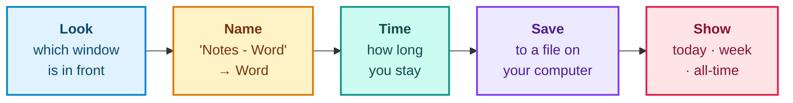
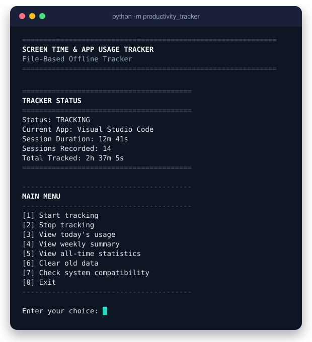
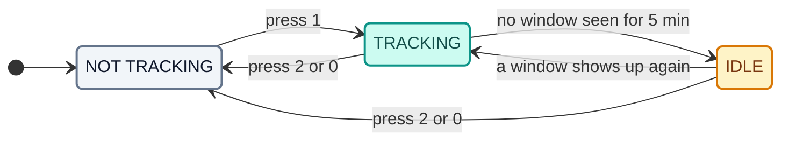
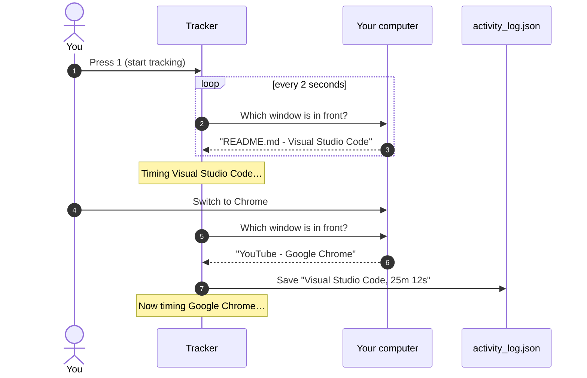
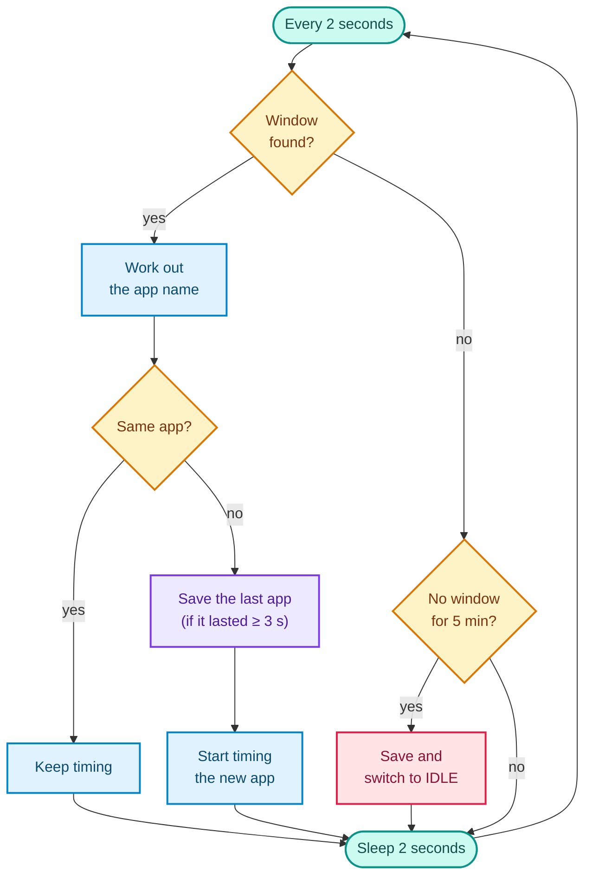
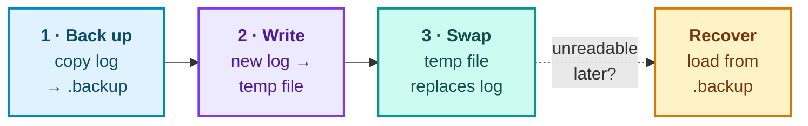
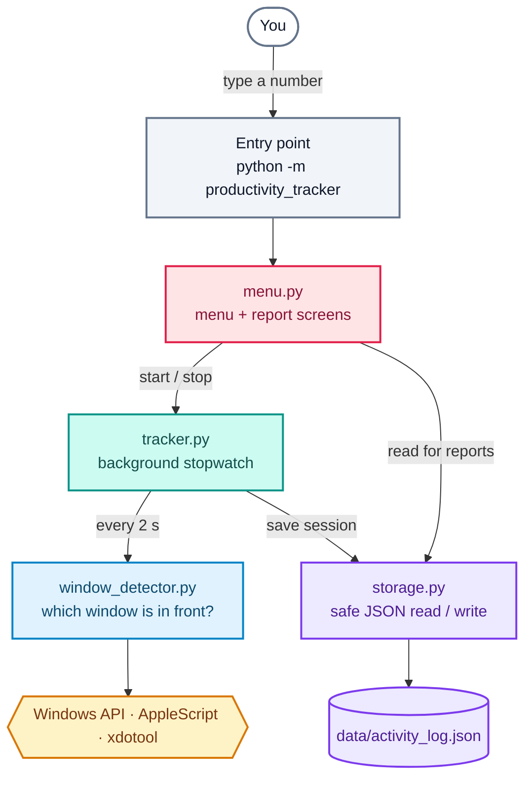

<p align="center">
  
</p>

<p align="center">
  
  
  
  
  
</p>

<p align="center">
  <b>A tiny terminal app that quietly notes which app you're using, and for how long.</b><br>
  No accounts. No internet. No installs. Just Python and a file on your own computer.
</p>

<p align="center">
  <a href="#quick-start">Quick Start</a> ·
  <a href="#using-the-app">Using the App</a> ·
  <a href="#reports">Reports</a> ·
  <a href="#how-it-works">How It Works</a> ·
  <a href="#your-data--privacy">Your Data</a> ·
  <a href="#troubleshooting">Troubleshooting</a>
</p>

<br>

## What is this?

Ever finish a day and wonder where it went? **Screen Time Tracker** answers that. Start it, minimise it, and carry on with your day. It keeps an eye on which window you're using and turns that into simple reports like *"3h 36m today: 50% VS Code, 42% Chrome."*



<table>
  <tr>
    <td width="33%" valign="top">
      <b>Private by design</b><br>
      Your history is a plain file on <i>your</i> computer. The app never connects to the internet.
    </td>
    <td width="33%" valign="top">
      <b>Zero dependencies</b><br>
      Built only from Python's standard library. Nothing to <code>pip install</code>, nothing to configure.
    </td>
    <td width="33%" valign="top">
      <b>Windows · macOS · Linux</b><br>
      Uses each system's own built-in tools to see which app is in front.
    </td>
  </tr>
  <tr>
    <td width="33%" valign="top">
      <b>Instant reports</b><br>
      Today, the last 7 days, or all time, with percentages and little bar charts.
    </td>
    <td width="33%" valign="top">
      <b>Crash-safe saving</b><br>
      Writes to a temporary file first and keeps a backup, so a crash mid-save won't wipe your history.
    </td>
    <td width="33%" valign="top">
      <b>Dead-simple menu</b><br>
      Type a number, press Enter. That's the whole interface.
    </td>
  </tr>
</table>

<br>

## Quick Start

> [!TIP]
> **Already comfortable with a terminal?** These two commands are all you need:
> ```bash
> git clone https://github.com/Shreya20002/productivity_tracker.git
> python -m productivity_tracker
> ```

New to all this? No problem. Follow the four steps below.

### Step 1: Make sure you have Python

Open a terminal:

| Your computer | How to open a terminal |
| :-- | :-- |
| **Windows** | Press the <kbd>Windows</kbd> key, type **Terminal** (or **PowerShell**), press <kbd>Enter</kbd> |
| **macOS** | Press <kbd>Cmd</kbd> + <kbd>Space</kbd>, type **Terminal**, press <kbd>Enter</kbd> |
| **Linux** | Press <kbd>Ctrl</kbd> + <kbd>Alt</kbd> + <kbd>T</kbd> (on most distributions) |

Then type this and press <kbd>Enter</kbd>:

```bash
python --version
```

If you see `Python 3.7` or higher, you're set. On macOS or Linux, try `python3 --version` if `python` isn't found.
No Python yet? Download it free from **[python.org/downloads](https://www.python.org/downloads/)**.

> [!NOTE]
> **Windows users:** in the Python installer, tick **"Add python.exe to PATH"** before clicking *Install*.

### Step 2: Download the project

**Option A: with Git**

```bash
git clone https://github.com/Shreya20002/productivity_tracker.git
```

**Option B: without Git**

1. On this GitHub page, click the green **Code** button → **Download ZIP**.
2. Unzip it.
3. GitHub names the folder `productivity_tracker-main`. **Rename it to `productivity_tracker`**.

> [!IMPORTANT]
> The folder **must** be called exactly `productivity_tracker`. Python uses the folder name to find the app.

### Step 3: Stand in the right place

Your terminal needs to be in the folder that **contains** `productivity_tracker`, not inside it:

```text
Projects/                    ← your terminal should be HERE
└── productivity_tracker/    ← the folder you downloaded
    ├── __main__.py
    ├── menu.py
    └── ...
```

If you used `git clone`, you're already in the right place. If you unzipped into Downloads, run `cd Downloads` first.

### Step 4: Run it

```bash
python -m productivity_tracker
```

> On macOS and Linux, use `python3` instead of `python`. On Windows, `py -m productivity_tracker` also works.

You'll see the main menu. Press <kbd>1</kbd> then <kbd>Enter</kbd> to start tracking.

<details>
<summary><b>Extra step for macOS</b></summary>
<br>

The first time you start tracking, macOS will ask whether your terminal may control **System Events**. Click **OK**. That's how the app reads which app is in front.

Clicked "Don't Allow" by mistake? Open **System Settings → Privacy & Security → Automation**, find your terminal app, and switch on **System Events**.
</details>

<details>
<summary><b>Extra step for Linux</b></summary>
<br>

Linux needs a small helper tool to see the active window. Install **one** of these:

```bash
sudo apt install xdotool        # Ubuntu / Debian / Mint
sudo dnf install xdotool        # Fedora
sudo pacman -S xdotool          # Arch / Manjaro
```

(`xprop` from the `x11-utils` package also works as a fallback.)

These tools work in **X11 (Xorg)** sessions. Many newer distributions default to **Wayland**, where they can't see most windows. If tracking shows nothing, log out, click the gear icon on the login screen, and choose an **Xorg** session (for example *"Ubuntu on Xorg"*).
</details>

<details>
<summary><b>Extra step for Windows</b></summary>
<br>

None. The app talks to Windows directly through Python's built-in `ctypes` module.
</details>

> [!TIP]
> Not sure if your computer is supported? Choose **`7` · Check system compatibility** in the menu. It tests window detection on the spot.

<br>

## Using the App

<p align="center">
  
</p>

Everything happens through this menu. Type a number and press <kbd>Enter</kbd>:

| Key | Option | What it does |
| :-: | :-- | :-- |
| <kbd>1</kbd> | **Start tracking** | Starts recording in the background. The menu stays usable. |
| <kbd>2</kbd> | **Stop tracking** | Saves the app you're on right now and stops. Asks you to confirm. |
| <kbd>3</kbd> | **View today's usage** | Total screen time, time per app with percentages, and your last 10 sessions. |
| <kbd>4</kbd> | **View weekly summary** | The last 7 days with a bar for each day, plus your top 5 apps. |
| <kbd>5</kbd> | **View all-time statistics** | Everything since you started, including your top 10 apps. |
| <kbd>6</kbd> | **Clear old data** | Deletes entries older than *N* days (default 30). Asks you to confirm. |
| <kbd>7</kbd> | **Check system compatibility** | Shows your OS and Python version and tests window detection. |
| <kbd>0</kbd> | **Exit** | Saves anything in progress, then quits. |

### A typical day

1. **Morning:** run `python -m productivity_tracker`, press <kbd>1</kbd>.
2. **Minimise** the terminal window and work as usual.
3. **Curious?** Bring the window back and press <kbd>3</kbd> to see today so far.
4. **Evening:** press <kbd>0</kbd> to save and exit.

> [!IMPORTANT]
> The tracker only runs **while its window is open**. Minimising is fine, but closing the window stops it.
> To quit safely, use <kbd>0</kbd> or <kbd>Ctrl</kbd>+<kbd>C</kbd>. Both save the session in progress first.

### What the status panel means

The box at the top of the menu tells you what the tracker is doing right now:



<br>

## Reports

Here's what each report looks like (generated from a week of sample data):

<details open>
<summary><b>Today's usage</b>: option <kbd>3</kbd></summary>

```text
  TODAY'S USAGE (2026-10-11)
==================================================

  Total Screen Time: 3h 36m
  Applications Used: 4
  Sessions: 9

  ----------------------------------------------
  Application                              Time
  ----------------------------------------------
  Visual Studio Code             1h 48m 34s (50.3%)
  Google Chrome                  1h 30m 52s (42.1%)
  Windows Terminal                   8m 58s ( 4.2%)
  Microsoft Word                     7m 36s ( 3.5%)
  ----------------------------------------------

  ACTIVITY TIMELINE
  ----------------------------------------------
  2026-10-11 09:00:00  Visual Studio Code        37m 17s
  2026-10-11 09:37:52  Windows Terminal          8m 58s
  2026-10-11 09:48:41  Visual Studio Code        57m 49s
  2026-10-11 10:48:09  Google Chrome             12m 13s
  2026-10-11 11:02:22  Google Chrome             28m 26s
  2026-10-11 11:32:38  Microsoft Word            7m 36s
  2026-10-11 11:41:26  Google Chrome             24m 52s
  2026-10-11 12:08:14  Google Chrome             25m 21s
  2026-10-11 12:35:22  Visual Studio Code        13m 28s
```
</details>

<details open>
<summary><b>Weekly summary</b>: option <kbd>4</kbd></summary>

```text
  WEEKLY SUMMARY (2026-10-04 to 2026-10-11)
==================================================

  Total Screen Time: 35h 17m 59s
  Daily Average: 5h 2m 34s
  Applications Used: 6
  Total Sessions: 102

  DAILY BREAKDOWN
  ----------------------------------------------
  Mon 2026-10-05      5h 12m  ██████████
  Tue 2026-10-06      6h 48m  █████████████
  Wed 2026-10-07   4h 5m 59s  ████████
  Thu 2026-10-08      7h 18m  ██████████████
  Fri 2026-10-09      5h 54m  ███████████
  Sat 2026-10-10      2h 24m  ████
  Sun 2026-10-11      3h 36m  ███████
  ----------------------------------------------

  TOP APPLICATIONS
  ----------------------------------------------
  1. Visual Studio Code             17h 47m 9s
  2. Google Chrome                  11h 7m 34s
  3. Microsoft Word                 2h 17m 38s
  4. Windows Terminal               2h 17m 16s
  5. Slack                          1h 9m 36s
```

Each `█` is 30 minutes.
</details>

<details>
<summary><b>All-time statistics</b>: option <kbd>5</kbd></summary>

```text
  ALL-TIME STATISTICS
==================================================

  Tracking Since: 2026-10-05
  Last Activity: 2026-10-11
  Days with Activity: 7

  Total Screen Time: 35h 17m 59s
  Daily Average: 5h 2m 34s
  Total Sessions: 102
  Unique Applications: 6

  TOP 10 APPLICATIONS (ALL TIME)
  ----------------------------------------------
   1. Visual Studio Code           17h 47m 9s (50.4%)
   2. Google Chrome                11h 7m 34s (31.5%)
   3. Microsoft Word               2h 17m 38s ( 6.5%)
   4. Windows Terminal             2h 17m 16s ( 6.5%)
   5. Slack                         1h 9m 36s ( 3.3%)
   6. Spotify                         38m 46s ( 1.8%)
  ----------------------------------------------
```
</details>

<br>

## How It Works

### The short version

The tracker works like a stopwatch that restarts every time you switch apps:



### Under the hood: one tick of the loop

Every two seconds, a background thread runs through this checklist:



### How it sees the active window

There's no special driver or extension. The tracker borrows a tool your operating system already has:

| System | Tool used | What it asks |
| :-- | :-- | :-- |
| **Windows** | Python's built-in **ctypes** + the `user32.dll` Windows API | *"What's the title of the foreground window?"* |
| **macOS** | **AppleScript** via `osascript` | *"Which application is frontmost?"* |
| **Linux** | **xdotool** (falls back to **xprop**) | *"What's the name of the active window?"* |

<br>

## Your Data & Privacy

### Where it lives

Everything is saved in one file inside the project folder:

```text
productivity_tracker/data/activity_log.json
```

This folder is listed in `.gitignore`, so your history won't end up on GitHub by accident.

### What gets saved

Each time you leave an app, one small entry is added:

```json
{
  "app_name": "Visual Studio Code",
  "start_time": "2026-10-11T09:00:00.412630",
  "end_time": "2026-10-11T09:37:17.508941",
  "duration_seconds": 2237,
  "date": "2026-10-11"
}
```

| Field | Meaning |
| :-- | :-- |
| `app_name` | The app you were using |
| `start_time` / `end_time` | When the session began and ended, in your local time |
| `duration_seconds` | How long it lasted |
| `date` | The day it started, used to group reports |

It's plain JSON, so you can open it in any text editor or load it into your own scripts and spreadsheets.

### How the app name is worked out

The tracker saves an **app name**, not what's inside the window. On Windows and Linux it trims the window title down like this:

| The window title is… | Saved as | Rule |
| :-- | :-- | :-- |
| `Budget.xlsx - Excel` | `Excel` | Text after the last ` - ` |
| `README.md - productivity_tracker - Visual Studio Code` | `Visual Studio Code` | Text after the last ` - ` |
| `Settings: Display` | `Settings` | Text before the first `: ` |

If a title matches neither pattern, the whole title is saved. On macOS, the system reports the app's name directly (for example `Safari`).

> [!NOTE]
> Some apps put the page or document name in a title that doesn't fit these patterns. In that case the full window title is saved to your local file. It still never leaves your computer.

### How saving stays safe

Saving uses a three-step routine, so a crash or power cut mid-write can't corrupt your history:



> [!TIP]
> **Want a fresh start?** Use menu option <kbd>6</kbd> to delete entries older than a number of days, or delete `data/activity_log.json` and `data/activity_log.json.backup` to wipe everything.

<br>

## Settings

Three numbers control the tracker's behaviour. They live at the top of the `ActivityTracker` class in [`tracker.py`](tracker.py#L29-L32):

| Setting | Default | What it means |
| :-- | :-: | :-- |
| `POLL_INTERVAL` | `2` | Seconds between "which window is in front?" checks |
| `IDLE_THRESHOLD` | `300` | Seconds with no detectable window before switching to **IDLE** (5 minutes) |
| `MIN_SESSION_DURATION` | `3` | Sessions shorter than this many seconds are ignored, so quick <kbd>Alt</kbd>+<kbd>Tab</kbd> flicks don't clutter your log |

Change a number, save the file, and restart the app.

<br>

## Project Structure

```text
productivity_tracker/
├── __main__.py          ▸ entry point, what "python -m productivity_tracker" runs
├── menu.py              ▸ the numbered menu and every report screen
├── tracker.py           ▸ background thread that times each app
├── window_detector.py   ▸ asks Windows / macOS / Linux which window is in front
├── storage.py           ▸ safe JSON reading & writing, plus report maths
├── __init__.py          ▸ package info and version number
├── data/                ▸ your activity log lives here (git-ignored)
├── assets/              ▸ images used in this README
├── requirements.txt     ▸ empty on purpose: no dependencies
├── setup.py
└── LICENSE
```

How the pieces talk to each other:



<br>

## Troubleshooting

<details>
<summary><b><code>No module named productivity_tracker</code></b></summary>
<br>

Python can't find the app folder. Check two things:

1. The folder is named exactly **`productivity_tracker`**, not `productivity_tracker-main`.
2. Your terminal is in the folder that **contains** it, not inside it. If you're inside, run `cd ..` and try again.
</details>

<details>
<summary><b><code>'python' is not recognized</code> or <code>command not found: python</code></b></summary>
<br>

- **Windows:** try `py -m productivity_tracker`. If that fails too, reinstall Python and tick **"Add python.exe to PATH"**.
- **macOS / Linux:** use `python3` instead of `python`.
</details>

<details>
<summary><b>My report is empty, or today's total looks too low</b></summary>
<br>

A session is saved **when you switch away from an app** (or stop tracking). The app you're using right now won't appear until you switch, press <kbd>2</kbd>, or exit with <kbd>0</kbd>.

Sessions shorter than 3 seconds are skipped on purpose.
</details>

<details>
<summary><b>"Window detection is NOT AVAILABLE" (Linux)</b></summary>
<br>

Install `xdotool` (see the Linux step under [Quick Start](#quick-start)) and make sure you're in an **X11 / Xorg** session rather than Wayland.
</details>

<details>
<summary><b>Nothing is tracked on macOS</b></summary>
<br>

Your terminal probably isn't allowed to talk to System Events. Go to **System Settings → Privacy & Security → Automation** and switch it on for your terminal app, then restart the tracker.
</details>

<details>
<summary><b>Does it keep tracking after I close the window?</b></summary>
<br>

No. The tracker lives inside the terminal window, so keep it open (minimised is fine). If you close the window directly, finished sessions are already safe. Only the app you were on at that moment is lost.
</details>

<br>

## Contributing

Ideas, bug reports and pull requests are all welcome.

1. Fork the repo and create a branch: `git checkout -b my-idea`
2. Make your change. Please keep it **standard-library only**. That's the whole point.
3. Open a pull request describing what you changed and why.

**Handy for testing:** run the window detector on its own (from the folder that contains `productivity_tracker`) to see what it reports for your current window:

```bash
python -m productivity_tracker.window_detector
```

<br>

## License

Released under the [MIT License](LICENSE). Use it, change it, share it.

<br>

<p align="center">
  <sub>Built with nothing but the Python standard library · © 2026 Shreya</sub>
</p>
